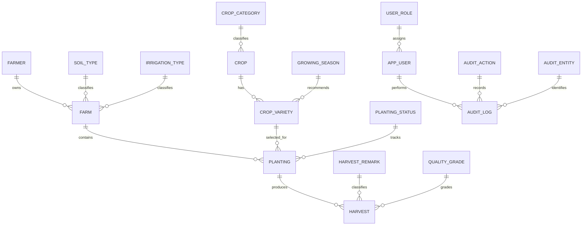

# Data design and normalization

## Relationships

## UNF

A raw farm activity sheet can combine farmer contact details, farm attributes, crop varieties, planting cycles, and multiple harvests in one row. Repeated planting and harvest groups, plus repeated descriptions, create update and deletion anomalies.

## 1NF

Each row represents one farmer, farm, crop type, crop variety, planting, or harvest. Values that can repeat are stored as separate rows; names, dates, measurements, and addresses remain single values in their columns.

## 2NF

Tables use a single-column surrogate primary key. Each descriptive attribute belongs to that one entity: farm attributes to a farm, variety growing facts to a crop variety, planting facts to a planting, and harvest measurements to a harvest.

## 3NF

Controlled descriptions are kept in lookup tables and operational rows store their integer foreign keys. Crop category depends on the crop type, while growing period and recommended season depend on a specific crop variety. Therefore `crop` and `crop_variety` are separate. Planting refers to a variety; harvest refers to a planting. User roles, planting states, soil types, irrigation types, seasons, grades, remarks, audit actions, and audit entity types each have their own table.

The text `code` columns in lookup tables are unique stable identifiers for application seed data. Operational relationships use the numeric primary keys. Human-readable labels are stored once in each lookup table.

## Attribute types

Integer types are used for primary and foreign keys, growing-period day counts, audit references, and sort order. Contact numbers stay text so leading zeroes and `+` signs are retained. Dates, areas, yields, and prices retain date and decimal types because arithmetic and range validation matter for those values. Free-form address and farm-location text is not converted to artificial IDs.

## Main keys and constraints

`farmer(farmer_id)`, `farm(farm_id)`, `crop(crop_id)`, `crop_variety(variety_id)`, `planting(planting_id)`, and `harvest(harvest_id)` are entity keys. Lookup tables use `SMALLINT` identity keys; large operational tables use `BIGINT` identity keys. The `crop_variety` table has a unique `(crop_id, variety_name)` pair.

Foreign keys implement the 1:M relationships. Areas and growing days must be positive where present; seed quantity, yield, and price cannot be negative; expected harvest cannot precede planting. Timestamps are maintained on operational tables. Farmer/farm removal cascades to dependent operations; crop-variety and remark deletion is restricted if referenced.

`audit_log.entity_record_id` is intentionally polymorphic: `entity_type_id` identifies which table the number belongs to. A conventional foreign key cannot point to several different tables at once.
