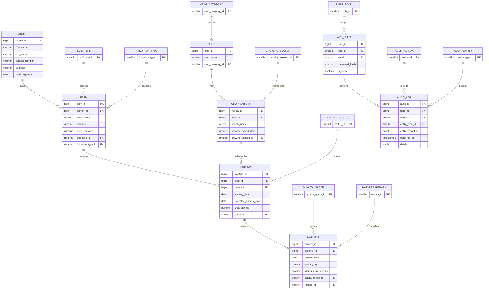

# AgriInfo System Documentation

**Project:** AgriInfo: Agriculture Information System  
**Platform:** PHP, PostgreSQL (Supabase), PDO, Bulma CSS  
**Audience:** Project reviewers, administrators, staff, and maintainers

## 1. Project description

AgriInfo is a web-based agriculture information system for recording farmer and farm details, crop varieties, planting cycles, and harvest results. It provides role-based access for Administrators and Staff, tracks important changes in audit logs, and summarizes farm and crop performance in date-filtered reports.

## 2. Project objectives

- Keep farmer, farm, crop, planting, and harvest records in one relational database.
- Help staff manage planting schedules, expected harvest dates, farm capacity, and harvest results.
- Reduce data entry errors with validation, lookup lists, and database constraints.
- Give Administrators account management, audit history, and performance reporting tools.
- Present operational information through responsive dashboards and role-specific navigation.

## 3. Functional requirements

### Accounts and access

- Users can sign in and sign out with email and password.
- Passwords are stored as hashes; form submissions use CSRF protection.
- Staff can use operational areas. Administrator-only areas include user administration, reports, and full audit logs.
- Active-user tracking uses recent activity and sign-out state; activity expires after eight hours.

### Operational records

- Authorized users can create, view, edit, filter, sort, and paginate farmer, farm, crop, variety, planting, and harvest records.
- Forms use database-backed dropdowns for related records and fixed reference values.
- Success, error, and informational feedback appears in theme-styled popup notifications. Success and informational notices dismiss automatically; errors remain until dismissed.
- Delete confirmations identify the selected record and describe the related records that would be deleted by database cascades. If a record is still referenced and cannot be deleted, the dialog explains the relationship that must be cleared first; the server checks this again when processing a deletion.
- Planting status overrides that fall outside the date-based guideline require an in-app confirmation dialog before saving.
- Planting entry calculates expected harvest date from variety growing-period days, checks remaining farm area, and validates planting status against the planting and harvest dates.
- Harvest entry is limited to plantings that are ready to harvest. Quantity and selling price are used to show an estimated gross total; saving a harvest updates the planting status.
- Dashboard watch lists highlight planting and harvest items that need attention. Dashboard lists paginate when they exceed seven items; module lists paginate when they exceed ten.

### Oversight and reporting

- Administrators can add or edit user accounts and review audit activity.
- Audit logs record sign-in/sign-out and record changes with date, action, module, user, and concise change details. A **View details** popup displays the available record fields, creation timestamp, before/after snapshots for updates, and related-row counts for deletions. Sensitive password/hash fields are excluded.
- Administrators can build farm or crop performance reports with a date range, grouping, metric, filters, and sort direction. Measures include recorded and projected quantity/value, harvest count, average yield, quality, and cancelled plantings.

## 4. Entity-Relationship Diagram

The diagram below shows the core entities and their one-to-many relationships. Lookup/reference tables are shown as separate entities; `audit_log.entity_record_id` is polymorphic and is identified by `audit_entity`, so it cannot use a normal foreign key to every possible target table.

## 5. Normalization: UNF through 3NF

### Unnormalized form (UNF)

A single farm activity sheet could repeat farmer, farm, crop, planting, and harvest information in the same row. A farm with several plantings and a planting with several harvests require repeating groups. Repeated descriptions also create inconsistent updates, accidental deletion of useful details, and duplicate data entry.

### First normal form (1NF)

Each record represents one entity or event, and each field stores one value. Farmers, farms, crops, varieties, plantings, and harvests are recorded as separate rows. Multiple harvests are represented as multiple harvest rows rather than repeating columns in a planting record.

### Second normal form (2NF)

Each table has a primary key. Descriptive attributes belong to the entity identified by that key: farm details to a farm, variety growing facts to a variety, planting facts to a planting, and quantity/price/grade to a harvest. The crop-variety natural pair is also protected by a unique constraint on `(crop_id, variety_name)`.

### Third normal form (3NF)

Lookup descriptions and categories are stored once in reference tables and referenced by integer foreign keys. A crop category depends on the crop, while growing period and recommended growing season depend on a specific variety; therefore crop and variety are separate. Planting points to a farm and a variety; harvest points to a planting. Roles, statuses, soil types, irrigation types, grades, remarks, audit actions, and audit entity types are also stored separately. This avoids transitive dependencies such as a planting row storing a crop name that is already determined by its variety.

Operational primary and foreign keys use integer types where appropriate. Dates remain `DATE`, measured quantities/areas/prices use `NUMERIC`, and contact information remains text to preserve formatting such as leading zeroes and `+` signs.

For the complete normalization notes, see [normalization.md](normalization.md).

## 6. Data dictionary

| Table | Primary key | Purpose |
| --- | --- | --- |
| `farmer` | `farmer_id` | Farmer name, contact, address, and registration date. |
| `farm` | `farm_id` | Farm owner, name, location, area, soil type, and irrigation type. |
| `soil_type` | `soil_type_id` | Controlled soil values in the display-ready `code` column. |
| `irrigation_type` | `irrigation_type_id` | Controlled irrigation values in `code`. |
| `crop` | `crop_id` | Crop type and category. |
| `crop_category` | `crop_category_id` | Controlled crop categories in `code`. |
| `crop_variety` | `variety_id` | Variety, parent crop, growing period, and recommended season. |
| `growing_season` | `growing_season_id` | Controlled growing-season values in `code`. |
| `planting` | `planting_id` | Farm, variety, planting/expected harvest dates, area, seed, and status. |
| `planting_status` | `status_id` | Planting lifecycle values in `code`. |
| `harvest` | `harvest_id` | Planting, harvest date, quantity, price, grade, and remark. |
| `quality_grade` | `quality_grade_id` | Harvest quality values in `code`. |
| `harvest_remark` | `remark_id` | Harvest remarks in `code`. |
| `app_user` | `user_id` | Login identity, role, activity state, and password hash. |
| `user_role` | `role_id` | Administrator and Staff roles in `code`. |
| `audit_log` | `audit_id` | User/action/entity references, record ID, timestamp, and JSON change details. |
| `audit_action` | `action_id` | Login/logout and create/update/delete values in `code`. |
| `audit_entity` | `entity_type_id` | Display-ready entity names in `code`. |

For column types, nullable fields, and detailed rules, see [data-dictionary.md](data-dictionary.md) and [the schema](../sql/schema.sql).

## 7. Table relationships and constraints

- One farmer can own multiple farms; each farm references one farmer. Deleting a farmer cascades to their farms and dependent planting/harvest records.
- One crop has many varieties; a crop-variety name pair must be unique. Deleting a crop cascades to varieties, while a variety referenced by a planting is protected from deletion.
- One farm and one crop variety can each be referenced by many plantings. Each planting has one status and belongs to one farm and variety.
- One planting can have many harvest records. Deleting a planting cascades to its harvest rows.
- Lookup foreign keys connect farms, crops, varieties, plantings, harvests, and users to their corresponding lookup rows. Each lookup stores its display-ready name in one unique `code` column; it has no separate label or description column.
- Deleting a user sets the audit log's `user_id` to `NULL`, preserving historical events. Audit action and entity types are foreign keys. `entity_record_id` is polymorphic and intentionally has no direct foreign key.
- Emails, crop names, lookup codes, and crop-variety pairs have uniqueness rules. Positive area/growing-period and nonnegative seed/yield/price checks are enforced where applicable. Expected harvest date cannot precede planting date.
- Operational tables maintain creation/update timestamps. The database schema defines the authoritative constraints and delete behavior.

## 8. Screenshots of the working system

No working-system screenshots are currently available in the project files. The images in `img/` are branding assets, not screenshots, and the configured application/database session needed to capture real pages was not available during documentation preparation. Add genuine captures to `docs/screenshots/` and replace this note with embedded images after running the application.

Recommended captures:

| Capture | Suggested file | What it should show |
| --- | --- | --- |
| Login | `docs/screenshots/login.png` | Sign-in form without credentials visible. |
| Staff dashboard | `docs/screenshots/staff-dashboard.png` | Operational snapshot and field activity. |
| Planting form | `docs/screenshots/planting-form.png` | Farm/variety details, remaining area, and calculated date. |
| Harvest form | `docs/screenshots/harvest-form.png` | Planting details and estimated gross total. |
| Administrator reports | `docs/screenshots/reports.png` | Date filters, chart, and performance table. |
| Audit log | `docs/screenshots/audit-log.png` | Date/module filters and readable audit activity. |

Do not include passwords, connection strings, or private personal information in screenshots.

## 9. Testing results

### Checks completed

- PHP syntax validation (`php -l`) passed for all PHP files in the local project.
- The local PHP runtime has the PostgreSQL PDO driver enabled, according to the existing project verification record.
- Route dispatch, CSRF-protected handlers, lookup usage, role checks, and schema/sample-data scripts were reviewed.

### Checks requiring a configured live database

The installer, live database connection, sign-in against PostgreSQL, CRUD persistence, report aggregation, and database constraints have not been confirmed against a running Supabase instance in this workspace. These checks require valid local database configuration and should be performed against a non-production database. See [testing.md](testing.md) for the verification record and manual checklist.

## 10. User guide / basic operating instructions

### Start the application

1. Configure the local `.env` file using [`.env.example`](../.env.example). Do not publish `.env` or share screenshots containing its values.
2. Ensure PHP has `pdo_pgsql` enabled, then start Apache in XAMPP.
3. Install or update the database from the project directory with `C:\xampp\php\php.exe install.php`. Follow the README's backup guidance before updating a database with existing records.
4. Open `http://localhost/Midterm%20Project/agri-info-system/` and sign in with an Administrator account provisioned during installation.

### Work with records

1. Use the navigation menu to open Farmers, Farms, Crops, Crop Varieties, Plantings, or Harvests allowed for your role.
2. Use the module fields to filter records; choose an order field and direction to sort. Use the page controls to move through longer lists.
3. Add or edit records with the page form. Choose related records from the dropdowns and follow validation messages. Planting expected harvest dates are calculated from the selected variety and planting date.
4. For a harvest, select a planting marked ready to harvest, enter date/quantity/price and other requested details, review the estimated total, then save.
5. Use dashboard watch items to open the related record. Administrator-only Users, Reports, and Audit pages are available from the Administrator navigation.
6. When deleting a record, review the confirmation dialog. It identifies the record and lists dependent data that will be removed, or explains if related plantings prevent the deletion.
7. Sign out when finished, especially on shared computers. Administrators can open Audit Logs and select **View details** to inspect the saved record snapshot and change information.

For installation settings and hosting details, see the [README](../README.md). For the code map, see [code-structure.md](code-structure.md).
